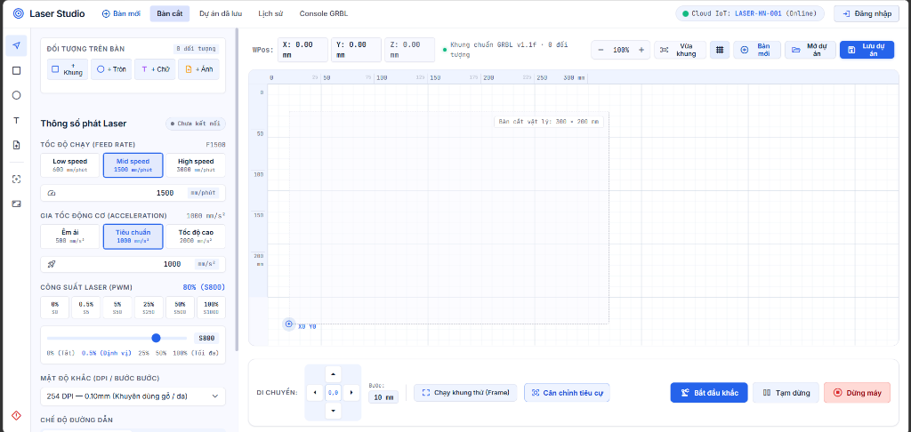
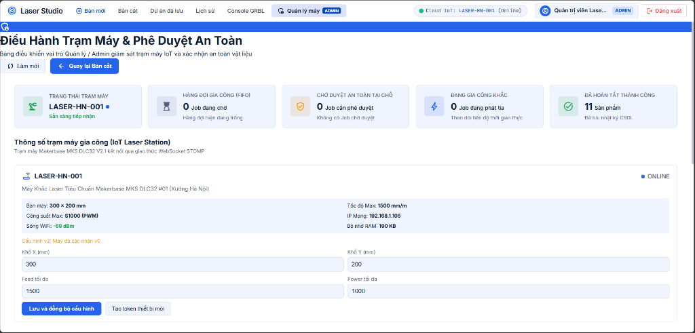
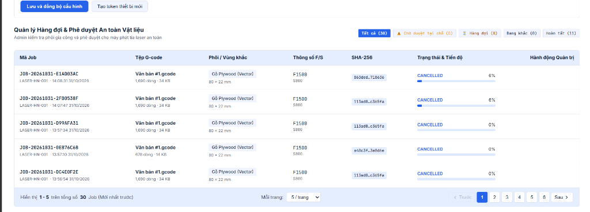
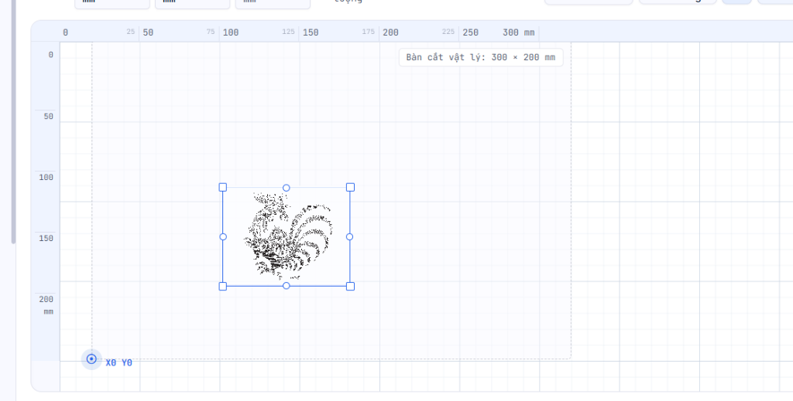

<div align="center">

# ⚡ LaserGUI — Web Controller & Laser Studio

### Hệ thống Web Studio điều khiển & điều hành trạm khắc Laser 2 trục X-Y qua Web Serial API và IoT Cloud WebSocket

[](https://react.dev/)
[](https://vitejs.dev/)
[](https://developer.mozilla.org/en-US/docs/Web/API/Web_Serial_API)
[](https://stomp.github.io/)
[](https://github.com/makerbase-mks/MKS-DLC32)
[](https://github.com/AnVu05)
[](https://github.com/AnVu05)
[](LICENSE)

<br />

<p align="center">
  <b>LaserGUI</b> là ứng dụng Web Single-Page Application (SPA) công nghiệp hiện đại, tích hợp toàn diện quy trình từ <b>thiết kế 2D Canvas</b>, <b>xử lý ảnh số Dithering</b>, <b>sinh mã G-code chuẩn GRBL</b>, truyền phát trực tiếp qua <b>Web Serial API</b> tại chỗ cho đến <b>điều hành trạm máy IoT Cloud từ xa</b>, quản lý <b>hàng đợi gia công FIFO</b> và <b>phê duyệt an toàn vật liệu 2 bước</b>.
</p>

</div>

---

## 📸 Giao diện Ứng dụng Thực tế (Showcase)

### 1. Toàn cảnh Không gian làm việc Laser Studio (Workspace Overview)
Giao diện trực quan hóa bàn khắc $300 \times 200\text{ mm}$, bảng cấu hình phát Laser PWM (Feed Rate, Gia tốc, Mật độ DPI), hệ thống phím Jogging 4 hướng và tích hợp chỉ báo trạng thái kết nối Cloud IoT trạm máy:



### 2. Bảng Điều Hành Trạm Máy & Giám Sát IoT Thời Gian Thực (Station IoT & Admin Dashboard)
Bảng điều khiển chuyên sâu dành riêng cho vai trò Quản lý / Kỹ thuật viên vận hành xưởng: Giám sát toàn diện các chỉ số trạm máy (Trạng thái trạm, Hàng đợi FIFO, Chờ duyệt an toàn tại chỗ, Đang gia công khắc, Đã hoàn tất), thông số vi điều khiển Makerbase MKS DLC32 (Địa chỉ IP, Cường độ sóng Wi-Fi RSSI, Bộ nhớ RAM Heap) và đồng bộ cấu hình phần cứng v2:



### 3. Quản Lý Hàng Đợi Gia Công (FIFO Queue) & Phê Duyệt An Toàn Vật Liệu
Giao diện điều phối hàng đợi thông minh cho phép khách hàng tạo yêu cầu gia công liên tục ngay cả khi máy đang bận. Tích hợp bộ lọc trạng thái đa năng, đối soát tính toàn vẹn mã G-code bằng hàm băm mật mã học **SHA-256**, theo dõi thanh tiến độ gia công thời gian thực và thực hiện phê duyệt an toàn trước khi chiếu tia:



### 4. Thuật toán Xử lý ảnh Dithering Floyd-Steinberg trên Bàn cắt
Minh họa đưa ảnh bitmap lên bàn khắc vật lý, xử lý ma trận điểm ảnh raster và định vị gốc phôi chuẩn xác không gây cháy xém:



---

## 🌟 Tính Năng Nổi Bật (Key Features)

### 1. 🎨 Bàn Làm Việc 2D Canvas Studio Chuyên Nghiệp
- **Khổ cắt vật lý chuẩn hóa**: Vùng làm việc tiêu chuẩn $300 \times 200\text{ mm}$ tương thích hoàn hảo với cơ cấu chuyển động trục đai 2 trục X-Y.
- **Thước đo & Tọa độ thời gian thực (WPos)**: Hiển thị tọa độ đầu khắc chính xác từng $0.1\text{ mm}$, hệ lưới millimeter hỗ trợ căn phôi nhanh chóng.
- **Đa dạng đối tượng thiết kế**:
  - Đối tượng vector hình học (Khung chữ nhật, Hình tròn/Ellipse).
  - Khắc chữ (Text Vector) tự động tính toán kích thước bao (Bounding Box).
  - Ảnh Bitmap (PNG, JPG, BMP) tự động tính toán kích thước tối ưu theo tỷ lệ gốc.
- **Công cụ điều hướng trực quan**: Phóng to/thu nhỏ (Zoom in/out), Vừa khung hình (Fit view), Bàn mới, nạp lại dự án đã lưu.

### 2. 🖼️ Thuật Toán Xử Lý Ảnh Số Chuyên Biệt Cho Khắc Laser Diode
- **Chuyển đổi Grayscale chuẩn ITU-R BT.601**: Áp dụng trọng số quang phổ chuẩn xác ($Y = 0.299R + 0.587G + 0.114B$).
- **Khuếch tán sai số Floyd-Steinberg Dithering**: Phân phối sai số điểm ảnh sang 4 pixel lân cận theo ma trận trọng số $\frac{7}{16}, \frac{3}{16}, \frac{5}{16}, \frac{1}{16}$, triệt tiêu răng cưa và tái hiện sắc thái tương phản cao trên bề mặt gỗ, da, mica.
- **Tinh chỉnh ảnh thời gian thực**: Điều chỉnh độ tương phản (Contrast), độ sáng (Brightness) và chế độ đảo màu âm bản (Invert).

### 3. ⚡ Bộ Sinh Mã G-Code Chuẩn GRBL Laser Mode ($32=1)
- **Tương thích GRBL v1.1f Laser Mode**: Tự động chèn `$32=1`, đơn vị milimét `G21`, hệ tọa độ tuyệt đối `G90`.
- **Điều chế xung công suất Laser PWM**: Điều khiển bật/tắt tia theo mã `M3 S[0..1000]` và ngắt phát tia an toàn `M5` khi di chuyển hành trình nhanh `G0`.
- **Trình mô phỏng đường chạy dao (Toolpath Visualizer)**: Hiển thị trực quan đường cắt laser G1 (đỏ) và di chuyển không tải G0 (vàng đứt nét), kiểm tra tràn biên khổ cắt (Bounds Checker).

### 4. 🔌 Kết Nối Trực Tiếp Qua Web Serial API (Local CNC USB)
- **Giao tiếp cổng COM trực tiếp từ trình duyệt**: Kết nối phần cứng thông qua Web Serial API với tốc độ Baud rate tiêu chuẩn `115200`.
- **Thuật toán Call-and-Response chống tràn bộ đệm**: Kiểm soát từng dòng lệnh chờ chuỗi phản hồi `ok` từ GRBL, khắc phục triệt để vấn đề tràn bộ đệm phần cứng giới hạn $127\text{ bytes}$.
- **Bàn phím Jogging D-Pad**: Di chuyển đầu khắc theo trục X±, Y± với bước nhảy linh hoạt ($0.1\text{ mm}$, $1\text{ mm}$, $10\text{ mm}$).
- **Chạy khung thử (Framing Bounding Box)**: Quét viền ngoài phôi với công suất tia cực yếu ($S5 - 0.5\%$) hỗ trợ định vị và căn cữ phôi an toàn.

---

### 🚀 CÁC TÍNH NĂNG MỚI NÂNG CẤP (NEW FEATURES)

### 5. 🌐 Hệ Thống Điều Hành IoT Cloud & Trạm Khắc Từ Xa (Remote Laser Station)
- **Kết nối thông minh qua WebSocket STOMP**: Giao tiếp hai chiều thời gian thực giữa Web Frontend, Spring Boot Cloud Server và bo mạch 32-bit Makerbase MKS DLC32 (ESP32).
- **Web Captive Portal & Tự Động Khôi Phục Wi-Fi (SoftAP Mode)**:
  - Khi mất kết nối mạng hoặc đổi địa điểm làm việc, bo mạch tự động kích hoạt chế độ **SoftAP** phát Wi-Fi nội bộ.
  - Người vận hành chỉ cần kết nối điện thoại/máy tính vào mạng phát của máy để cấu hình lại SSID & Password qua Web Portal mà không cần nạp lại firmware.
- **Giám sát sức khỏe trạm máy**: Hiển thị trực quan trạng thái kết nối Online/Offline, địa chỉ IP mạng nội bộ, cường độ sóng Wi-Fi (dBm) và dung lượng bộ nhớ RAM Heap khả dụng.
- **Đồng bộ tham số cấu hình phần cứng v2**: Cập nhật kích thước bàn khắc vật lý (Khổ X, Khổ Y), tốc độ tối đa và công suất cực đại trực tiếp từ giao diện Admin xuống EEPROM/NVS bo mạch.

### 6. ⏳ Hàng Đợi Gia Công Thông Minh FIFO (Smart Job Queue)
- **Giải quyết bài toán máy bận**: Khách hàng và người dùng có thể gửi yêu cầu khắc tới hệ thống bất kỳ lúc nào ngay cả khi máy khắc đang thực hiện một lệnh gia công khác (miễn là trạm máy đang Online).
- **Tự động xếp hàng FIFO (First-In, First-Out)**: Hệ thống tự động xếp lệnh vào hàng đợi, cấp phát mã Job duy nhất và số thứ tự chờ (`queuePosition`).
- **Thông báo hàng đợi thời gian thực**: Giao diện người dùng tự động cập nhật vị trí hàng đợi và trạng thái của Job theo thời gian thực mà không cần tải lại trang.

### 7. 🛡️ Quy Trình Phê Duyệt An Toàn 2 Bước (2-Stage Material Safety Approval)
- **Ngăn ngừa nguy cơ cháy nổ & hỏng phôi**: Khi Job được điều phối từ Web Client, lệnh gia công không tự ý chạy ngay mà chuyển vào trạng thái **"Chờ duyệt an toàn tại chỗ"** (`QUEUED` / `DISPATCHED`).
- **Đối soát tính toàn vẹn tệp G-code bằng mã băm SHA-256**: Hệ thống tính toán mã băm SHA-256 cho toàn bộ nội dung G-code và hiển thị trên bảng quản trị để đối chiếu, bảo đảm file không bị sai lệch hoặc chắp vá trên đường truyền mạng.
- **Cơ chế xác nhận an toàn của Quản trị viên (Admin Safety Gate)**:
  - Kỹ thuật viên tại xưởng kiểm tra phôi thực tế trên bàn máy (độ phẳng, loại vật liệu, khoảng cách tiêu cự thấu kính).
  - Nhấn nút **"Phê duyệt & Vào máy"** trên Dashboard để cấp quyền phát tia laser (`DISPATCHED` $\rightarrow$ `PRINTING`).

### 8. 📊 Bảng Điều Hành Trạm Máy Quản Trị (Admin & Operator Dashboard)
- **Thẻ thống kê tổng quan (Live Metric Cards)**:
  - 🟢 **Trạng thái trạm máy**: Báo hiệu sẵn sàng tiếp nhận hoặc đang vận hành.
  - ⏳ **Hàng đợi gia công (FIFO)**: Số lượng Job đang xếp hàng chờ vào máy.
  - 🛡️ **Chờ duyệt an toàn tại chỗ**: Số Job đã vào máy nhưng cần xác nhận từ Admin.
  - ⚡ **Đang gia công khắc**: Số lượng Job đang trực tiếp phát tia laser.
  - ✅ **Đã hoàn tất thành công**: Tổng số sản phẩm đã hoàn thiện lưu trong CSDL.
- **Bộ lọc trạng thái linh hoạt**: Phân loại tức thì danh sách gia công theo các tab `Tất cả`, `Chờ duyệt tại chỗ`, `Hàng đợi`, `Đang khắc`, `Hoàn tất`.
- **Cửa sổ Giám sát Telemetry Thời gian thực (Job Progress Modal)**: Theo dõi tiến độ phần trăm, dòng lệnh hiện tại, ước tính thời gian còn lại, biểu đồ nhiệt độ đầu khắc và cảm biến an toàn nắp che.

### 9. 🔬 Căn Chỉnh Tiêu Cự & Hiệu Chuẩn Nhiệt Quang Học (LM-C40 5.5W)
- Mô hình quang học chuyên sâu cho đầu khắc diode:
  - Tiêu cự làm việc chuẩn: $D_0 = 40.0\text{ mm}$
  - Bán kính eo chùm tia tại tiêu điểm: $W_0 = 0.04\text{ mm}$ (Spot $0.08\text{ mm}$)
  - Vùng hội tụ hiệu dụng (Rayleigh Range): $Z_R = 3.0\text{ mm}$
- Tự động cảnh báo suy giảm quang thông và đề xuất bù công suất khi khoảng cách lấy nét bị lệch khỏi tiêu điểm.

### 10. 📚 Thư Viện Vật Liệu Mẫu Chuẩn Hệ Thống (Material Presets)
Tích hợp sẵn thông số tốc độ (Feed Rate), công suất (PWM Power), số lượt cắt (Passes) và độ phân giải (DPI) tối ưu cho 6 loại vật liệu phổ biến:
- 🌲 **Gỗ ép Plywood (3mm)**: Cắt vector $350\text{ mm/min} - 100\%$, Khắc $2000\text{ mm/min} - 65\%$.
- 💎 **Mica Acrylic trong suốt (2.5mm)**: Cắt mép bóng gương $250\text{ mm/min} - 95\%$.
- 👜 **Da thuộc tự nhiên & Simili**: Khắc sắc nét chống cháy viền $3200\text{ mm/min} - 30\%$.
- 🪵 **Gỗ công nghiệp MDF (3mm)**: Bề mặt phẳng mịn, khắc logo tương phản cao $1800\text{ mm/min} - 70\%$.
- 📦 **Bìa Carton cứng & Giấy Kraft**: Tốc độ cắt cao $1200\text{ mm/min} - 60\%$.
- 🛡️ **Nhôm sơn tĩnh điện / Anodized**: Khắc bóc lớp oxit màu $1600\text{ mm/min} - 85\%$.

### 11. 🔐 Xác Thực An Toàn Đa Tầng & Phân Quyền Vai Trò
- **HttpOnly Cookie Authentication**: Bảo vệ token phiên làm việc an toàn tuyệt đối trước các tấn công Cross-Site Scripting (XSS).
- **Đăng ký xác thực Gmail OTP 6 số**: Xác thực chủ quyền email người dùng trước khi cấp tài khoản.
- **Phân quyền vai trò chặt chẽ (RBAC)**: Phân định rõ ràng giữa người dùng thông thường (`USER`) chỉ thiết kế/gửi Job và Quản trị viên (`ADMIN` / `OPERATOR`) có quyền điều hành trạm máy và phê duyệt phát tia.

---

## 🛠️ Ngăn Xếp Công Nghệ (Tech Stack)

| Lớp (Layer) | Công nghệ / Thư viện sử dụng | Mục đích chính |
| :--- | :--- | :--- |
| **Framework** | **React 18** | Quản lý Component trạng thái và giao diện người dùng SPA |
| **Build Tool** | **Vite 8** | Trình đóng gói siêu tốc với Hot Module Replacement (HMR) |
| **Hardware I/O (Local)** | **Web Serial API** | Giao tiếp nhị phân / ký tự với bo mạch CNC qua cáp USB |
| **IoT Realtime Stream** | **WebSocket + STOMP.js + SockJS** | Nhận telemetry gia công và điều khiển trạm máy từ xa qua Cloud |
| **Integrity Security** | **Web Crypto API (SHA-256)** | Tạo mã băm kiểm tra tính toàn vẹn file G-code |
| **Graphics Engine** | **HTML5 Canvas 2D API** | Vẽ bàn cắt, hiển thị điểm ảnh Dithering & Toolpath G-Code |
| **Styling** | **Vanilla CSS + Laser Studio Design System** | Giao diện Cyber-Industrial hiện đại, tối ưu hiệu năng hiển thị |
| **Icons** | **Google Material Symbols Outlined** | Bộ biểu tượng đồ họa công nghiệp hiện đại |
| **Backend Integration** | **Fetch API / RESTful API** | Tích hợp máy chủ Java 21 Spring Boot 3 & SQL Server |

---

## 📁 Cấu Trúc Thư Mục Frontend

```text
src/frontend/laser-engraving/
├── docs/                               # Tài liệu & hình ảnh chụp giao diện thực tế
│   └── images/
│       ├── laser-studio-overview.png   # Toàn cảnh không gian làm việc Laser Studio
│       ├── admin-station-dashboard.png # Bảng điều hành trạm máy & thông số IoT
│       ├── admin-job-queue-management.png# Quản lý hàng đợi gia công & phê duyệt an toàn
│       └── dithering-canvas-preview.png# Xem trước thuật toán Dithering trên bàn cắt
├── public/                             # Tài nguyên tĩnh (favicon.svg, icons.svg)
├── src/
│   ├── assets/                         # Vector & tài nguyên ảnh giao diện
│   ├── components/                     # Các thành phần giao diện chính
│   │   ├── App.jsx                     # Component trung tâm điều phối toàn bộ State
│   │   ├── Header.jsx                  # Thanh tiêu đề, trạng thái kết nối & Auth
│   │   ├── ToolRail.jsx                # Thanh công cụ bên trái (Chọn, Hình học, Text, Ảnh)
│   │   ├── LaserCanvas.jsx             # Bàn làm việc Canvas 2D 300x200mm
│   │   ├── ParameterPanel.jsx          # Cấu hình Feed rate, PWM, Gia tốc, DPI, Dithering
│   │   ├── BottomDock.jsx              # Cụm điều khiển Jogging X/Y, Khung thử, Bắt đầu, Dừng
│   │   ├── AdminDashboardView.jsx      # Bảng điều hành trạm máy, hàng đợi FIFO & duyệt an toàn
│   │   ├── JobProgressModal.jsx        # Popup giám sát tiến độ gia công thời gian thực qua WebSocket
│   │   ├── GCodeModal.jsx              # Xem trước G-code, mô phỏng Toolpath & điều phối IoT
│   │   ├── ConsoleModal.jsx            # Cửa sổ dòng lệnh Terminal GRBL Serial trực tiếp
│   │   ├── HistoryModal.jsx            # Quản lý lịch sử gia công và tải file .NC
│   │   ├── ProjectsModal.jsx           # Quản lý & nạp lại các dự án đã lưu
│   │   ├── NewProjectModal.jsx         # Tạo dự án mới cho người dùng hoặc khách vãn lai
│   │   ├── LaserParametersView.jsx     # Thư viện quản lý vật liệu mẫu (Material Presets)
│   │   ├── FocusCalibrationModal.jsx   # Căn chỉnh tiêu cự & hiệu chuẩn nhiệt quang học
│   │   └── AuthModal.jsx               # Đăng nhập, Đăng ký Gmail OTP, Google OAuth
│   ├── hooks/                          # Custom React Hooks
│   │   └── useJobWebSocket.js          # Hook kết nối WebSocket STOMP nhận telemetry gia công
│   ├── services/                       # Tầng kết nối REST API & WebSocket với Spring Boot
│   │   ├── apiConfig.js                # Cấu hình URL endpoint & headers
│   │   ├── authApi.js                  # Xác thực, đăng ký OTP, HttpOnly Cookie session
│   │   ├── gcodeApi.js                 # Yêu cầu sinh mã G-code từ Backend
│   │   ├── jobApi.js                   # Điều phối Job, truy vấn hàng đợi, lệnh điều khiển từ xa
│   │   ├── websocketService.js         # Quản lý vòng đời kết nối WebSocket STOMP
│   │   ├── historyApi.js               # Lưu và truy vấn lịch sử gia công
│   │   ├── materialApi.js              # Quản lý danh mục vật liệu mẫu
│   │   ├── projectApi.js               # Lưu trữ và nạp dữ liệu bàn khắc dự án
│   │   └── settingsApi.js              # Đồng bộ cấu hình tham số máy laser
│   ├── utils/                          # Bộ tiện ích thuật toán chuyên sâu
│   │   ├── grblSerialDriver.js         # Trình điều khiển Web Serial, Buffer 127 bytes
│   │   ├── laserImageProcessor.js      # Grayscale ITU-R BT.601, Floyd-Steinberg Dithering
│   │   └── laserThermalCalibrator.js   # Mô hình tính toán tiêu cự & nhiệt quang học LM-C40
│   ├── App.css                         # Bộ phong cách Laser Studio Design System
│   ├── index.css                       # Reset CSS & biến màu hệ thống
│   └── main.jsx                        # Điểm khởi động ứng dụng React
├── index.html                          # Trang HTML gốc
├── package.json                        # Khai báo phụ thuộc và kịch bản chạy
└── vite.config.js                      # Cấu hình Vite
```

---

## 💻 Yêu Cầu Phần Cứng & Trình Duyệt

### 1. Trình duyệt Web hỗ trợ
- ✅ **Google Chrome** (Phiên bản 89 trở lên) — *Khuyến nghị cho Web Serial API & WebSockets*
- ✅ **Microsoft Edge** (Phiên bản 89 trở lên)
- ✅ **Opera** (Phiên bản 75 trở lên)
- ⚠️ *Đối với chế độ điều khiển qua Cloud IoT/WebSocket: Hỗ trợ mọi trình duyệt hiện đại trên PC và điện thoại thông minh (Chrome, Edge, Firefox, Safari).*

### 2. Phần cứng Máy Khắc Laser
- **Bo mạch điều khiển**: Makerbase **MKS DLC32 V2.1** (Vi điều khiển 32-bit ESP32 tích hợp Wi-Fi) hoặc Arduino Nano + CNC Shield V3.
- **Firmware**: **GRBL v1.1f** hoặc **MKS-DLC32 Firmware** tùy biến (Đã kích hoạt Laser Mode `$32=1`, chế độ Web Captive Portal SoftAP).
- **Module phát Laser**: Laser Diode bước sóng 445nm công suất quang $5.5\text{ W}$ (Ví dụ: Laser Tree LM-C40) điều chế PWM qua chân Spindle.
- **Cáp kết nối**: Cáp USB truyền dữ liệu chống nhiễu (khi dùng Web Serial) hoặc kết nối qua mạng Wi-Fi cục bộ 2.4GHz (khi dùng Cloud IoT).

---

## 🚀 Hướng Dẫn Cài Đặt & Chạy Ứng Dụng (Quick Start)

### 1. Yêu cầu môi trường
- Đã cài đặt **Node.js** (Khuyến nghị phiên bản `>= 18.x` hoặc `20.x LTS`).
- Trình quản lý gói **npm** hoặc **yarn** / **pnpm**.

### 2. Các bước khởi chạy

```bash
# 1. Di chuyển vào thư mục dự án frontend
cd src/frontend/laser-engraving

# 2. Cài đặt các gói phụ thuộc
npm install

# 3. Khởi chạy máy chủ phát triển (Development Server)
npm run dev
```

Mở trình duyệt Web và truy cập vào địa chỉ:
```text
http://localhost:5173/
```

### 3. Đóng gói cho môi trường Production

```bash
npm run build
```
Mã nguồn sau khi tối ưu hóa sẽ được lưu trữ trong thư mục `dist/`, sẵn sàng đưa lên các máy chủ web như Nginx, Vercel hoặc đóng gói vào thư mục tài nguyên tĩnh của Spring Boot.

---

## 👨‍💻 Thông Tin Tác Giả & Đơn Vị Phát Triển

- **Tác giả phát triển**: **Vũ Đình Ân**
- **GitHub**: [@AnVu05](https://github.com/AnVu05)
- **Đơn vị OJT / Nghiên cứu**: **HYPERDATA LAB**
- **Dự án**: Nghiên cứu & Chế tạo Ứng dụng Web Điều khiển Máy Khắc Laser CNC phục vụ đồ án OJT.

---

## 📄 Giấy Phép (License)

Dự án được phân phối dưới giấy phép **MIT License**. Bạn được tự do sử dụng, chỉnh sửa và tích hợp cho mục đích học tập và nghiên cứu. Chi tiết xem tại tệp `LICENSE`.

<div align="center">
  <sub>Xây dựng với niềm đam mê cơ điện tử và công nghệ Web hiện đại 🚀</sub>
</div>
